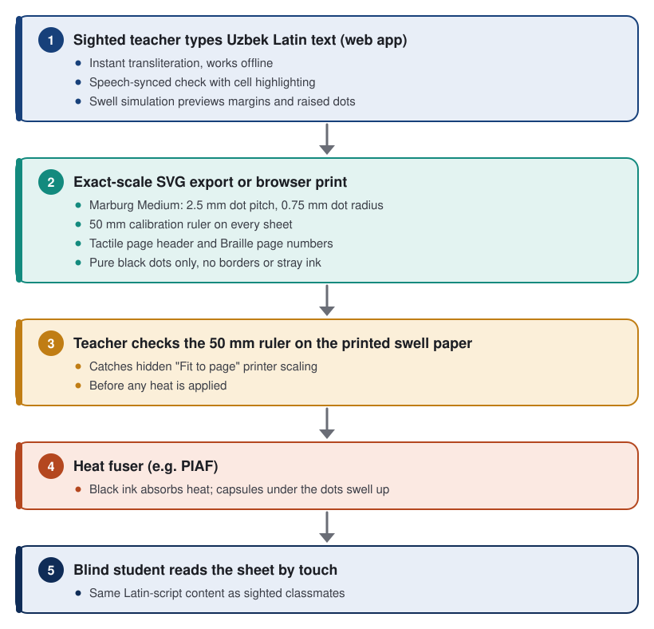

# Student Impact Statement: AlifBraille

**Project**: AlifBraille, a deterministic Uzbek Latin-to-Braille transliteration and tactile learning tool  
**Creator**: Elshod Kenjayev (solo student creator), Grade 11, Presidential School in Tashkent  
**Location**: Tashkent, Uzbekistan  
**Live app**: [braille.elshod.xyz](https://braille.elshod.xyz)  
**Pitch deck & demo video**: [braille.elshod.xyz/pitch](https://braille.elshod.xyz/pitch/)  
**Source code**: [github.com/Elshod09K/alifbraille](https://github.com/Elshod09K/alifbraille)  
**Competition**: SXSW EDU Student Impact Challenge, Austin, Texas  

---

## 1. Why I Care & The Problem

I'm a Grade 11 student at the Presidential School in Tashkent. Uzbekistan is moving its public education system, official textbooks and national university entrance exams from Cyrillic to the Uzbek Latin alphabet. In my own classes, almost everything is already in Latin.

When I started asking how blind and low-vision students are keeping up with this change, I found a gap that nobody seemed to be working on:

1. **The alphabet divide**: General classrooms have moved to Uzbek Latin, but most tactile books in school libraries were produced in Cyrillic Braille. The children in Uzbekistan's specialized schools for blind and low-vision students still have far fewer Latin Braille materials than their sighted peers have Latin textbooks.
2. **Uzbek Latin is tricky to transliterate**: It uses modified letters (`o‘`, `g‘`), digraphs (`sh`, `ch`, `ng`) and the *tutuq belgisi* (apostrophe / glottal stop). People type the apostrophe in many different ways (`‘`, `'`, `’`, `` ` ``, `ʻ`). Generic tools confuse these with punctuation, split digraphs into two cells, or drop the Braille number sign (`⠼`).
3. **The sighted-teacher bottleneck**: Many subject teachers (history, literature, mathematics) don't read Braille. To make a tactile worksheet they have to wait for a specialist transcriber or guess, with no easy way to check the result.
4. **Swell paper needs exact files**: Swell paper plus a heat fuser (for example PIAF or Zychem machines) is a cheaper way to make raised-dot sheets than a commercial embosser, but only if the print file is exactly to scale.

### The 60-Second Pitch Opener

> "Good morning, Austin. My name is Elshod Kenjayev. I'm in Grade 11 at the Presidential School in Tashkent, Uzbekistan.
>
> Uzbekistan is moving its schools, textbooks and university entrance exams from Cyrillic to the Latin alphabet. In my classes, everything is already in Latin.
>
> Then I asked a simple question: what about students who read with their fingers? Most tactile books in school libraries were produced in Cyrillic Braille. There is no common, free tool that turns Uzbek Latin text into correct Braille, and most subject teachers can't read Braille to check a worksheet.
>
> So I built **AlifBraille**: a free, open-source web app that turns Uzbek Latin into correct 6-dot Braille as you type, prints it to scale on swell paper, and reads it aloud so a sighted teacher can check every cell. It already works. My next step is putting it in the hands of a real school."

---

## 2. What I Built: AlifBraille

AlifBraille is a working, open-source web app written in TypeScript. It runs 100% in the browser, works offline once loaded, and needs no server or account. It is built for blind students, the sighted teachers who prepare their materials, and inclusive classrooms:

- **Deterministic Latin-to-Braille engine**: Rule-based Uzbek Latin normalization and 6-dot Braille transcription. Handles all apostrophe variants (`o‘`, `g‘`), digraphs (`sh`, `ch`, `ng`), the number sign and punctuation.
- **Instant feedback while typing**: Typing re-render measured at 3.6 ms on a 500-character passage; the app's initial load is under 500 ms.
- **Marburg Medium SVG export**: A4 vector sheets built to the Marburg Medium tactile specification:
  - 2.5 mm dot pitch.
  - 0.75 mm dot radius.
  - 10.0 mm line pitch and 15 mm margins.
  - Tactile page header and Braille page numbers (`⠼⠁`).
- **50 mm calibration ruler and first-print tour**: Every exported sheet and print view carries a 50 mm reference mark. A 3-step "First Swell Print" tour (`Alt+T`) shows teachers how to check 1:1 scale with a desk ruler and avoid printer auto-scaling before heating.
- **10-question exam template**: A standardized 10-question exam preset (`state-entrance-exam-10q`) with tactile question dividers (`=== 1-SAVOL ===`), multiple-choice options and line wrapping.
- **Sighted proctor answer key** (`Alt+K`): For exam supervisors who don't read Braille. Shows each question's Latin text next to its Braille cells, line numbers and dot patterns, with offline HTML download and printing.
- **Swell simulation mode** (`Alt+V`): Teachers without a fuser at hand can preview A4 margins (15 mm) and raised-dot relief on screen.
- **Reverse quiz and dot inspector** (`Alt+Q`):
  - Braille-to-Latin flashcards with scoring, for sighted teachers learning 6-dot Braille.
  - A dot inspector: toggle dots 1–6 (mouse or keys 1–6) and see the Uzbek Latin letter, Unicode symbol and pronunciation in real time.
- **Speech-synced verification** (`Alt+L`, "Tinglash" / "Listen"): The Web Speech API reads the Uzbek text aloud while the matching Braille cells light up, so a teacher who can't read Braille can check the sheet. Audio is unlocked on the user's gesture so it also works on iOS/Safari.
- **Swell-paper printing**: A dedicated `@media print` stylesheet removes all interface elements and borders, leaving only black dots for the fuser.
- **Accessibility**: Full keyboard navigation, focus management in dialogs, arrow-key navigation across Braille cells, a high-contrast mode (at least 7:1, up to 18:1) and an English/Uzbek interface toggle.

---

## 3. What Is Verified So Far (and What Is Not)

I want to be precise about what I have and haven't done. Everything below can be checked in the code and its test suite.

### Verified: software and print geometry
- **393 automated tests pass across 14 test suites**, covering the normalizer, transliteration, SVG geometry, print/export, audio phonetics, speech sync, the quiz and accessibility.
- **Geometry**: Tests check that generated SVG dots use a 0.75 mm radius, 2.5 mm center-to-center pitch, 10.0 mm line pitch and 15 mm margins, matching Marburg Medium values.
- **Clean print output**: The print view contains only black dots, with no borders or stray marks that would swell under heat.
- **Performance**: 3.6 ms typing re-render on a 500-character passage; initial load under 500 ms.
- **Contrast**: High-contrast mode reaches up to 18:1, checked with automated browser tests.

### Built: curriculum-style test presets
1. **State Anthem of Uzbekistan** (*Davlat Madhiyasi*): modified letters (`o‘`, `g‘`) and stanza breaks.
2. **History exam prompt** (*Amir Temur Davlati Tarixi*): dates and numbers (`1336`, `1370`, `1405`) and proper nouns.
3. **Alisher Navoi's wisdom** (*Hikmatlar va Do‘stlik*): literary vocabulary and the glottal stop (`ta'lim`, `ma'rifat`).
4. **Elementary Braille drills** (*Boshlang‘ich Brayl Mashqlari*): letter sequences and vowel drills.
5. **Constitution, right to education** (*Ta’lim Olish Huquqi*): official legal text.
6. **State entrance exam (10 questions)**: a template in a multiple-choice entrance-exam format.

### Not done yet: classroom testing
I have **not** yet run a pilot with blind students or teachers. I'm not reporting reading speed, error rates or teacher time saved, because I haven't measured them. That is exactly what the next step is for (see Section 7).

---

## 4. Saving Paper and Money

1. **Swell paper is expensive and imported**: Every ruined sheet costs a school money it can't easily spare.
2. **Printer auto-scaling ruins sheets**: Many desktop printers default to "Fit to page" scaling (for example 94%). At 94%, a 2.50 mm dot pitch shrinks to about 2.35 mm. Once the sheet goes through the fuser, the dots are permanent and the sheet can't be fixed.
3. **Check before heating**: AlifBraille gives teachers two checks before they use a sheet:
   - Hold an ordinary ruler against the **50 mm calibration mark** printed on every sheet.
   - Turn on **swell simulation mode (`Alt+V`)** to see margins, layout and raised-dot relief on screen.
4. **Less waste**: Catching scaling errors before heating means fewer ruined sheets and less coated-paper waste.

---

## 5. The Digital-to-Physical Workflow

---

## 6. Sighted Proctor Answer Key for Inclusive Testing

When blind students take a test, the proctor is usually a sighted adult who doesn't read Braille. AlifBraille includes a downloadable **sighted proctor answer key** (`Alt+K`):
- Lists each of the 10 template questions with the Latin answer text and its Braille cells.
- Gives exact line and cell positions (e.g. Question 1, correct answer `B) Alisher Navoiy`, starts at line 4, cells 1–2: `⠠⠃⠐`).
- Shows the dot pattern for every character, so a proctor can check answers visually without Braille training.
- Downloads as a standalone HTML sheet for printing.

---

## 7. Roadmap: Goals, Not Results

The steps below are plans. Only the first one is done.

- **Now (done)**: A working, tested, open-source app (393 passing tests across 14 suites), exact Marburg geometry, the exam template, proctor key and reverse quiz.
- **Next step (planned): a pilot with a specialized school for visually impaired students in Tashkent.**
  - Teachers use AlifBraille to make real worksheets from their own lessons.
  - Blind and low-vision students read the printed swell-paper sheets and tell me what's hard to read or wrong.
  - I'll measure, honestly and for the first time, how readable the sheets are and how long a teacher needs to prepare one.
- **Then (goal)**: Fix what the pilot finds, publish free tactile practice packets, and offer AlifBraille to specialized schools in other regions of Uzbekistan and Karakalpakstan.
- **Later (goal)**:
  - Ask Braille specialists and education authorities to review the mapping and the print workflow.
  - Build tactile practice packets in the state exam format, with matching proctor keys.
  - Extend the mappings to related Turkic Latin alphabets (Karakalpak, Kazakh).

---

## 8. Why SXSW EDU

SXSW EDU is the right place to show a problem most people never think about: when a country changes its alphabet, students who read Braille can be left behind. In Austin I hope to:

1. Get feedback on the tool from accessibility and special education experts before the pilot.
2. Show other students from Central Asia that careful, rule-based engineering can make a real difference for disability inclusion.
3. Meet people who can help with tactile literacy for languages that big Braille tools don't cover.

No student should be locked out of learning because of the script their books are printed in. AlifBraille is my attempt to make sure blind students in Uzbekistan can read the same Latin-script material as everyone else.
